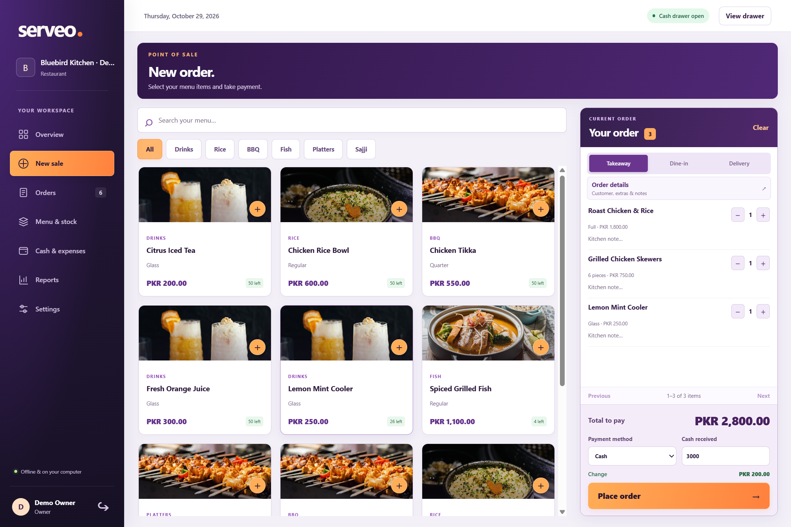
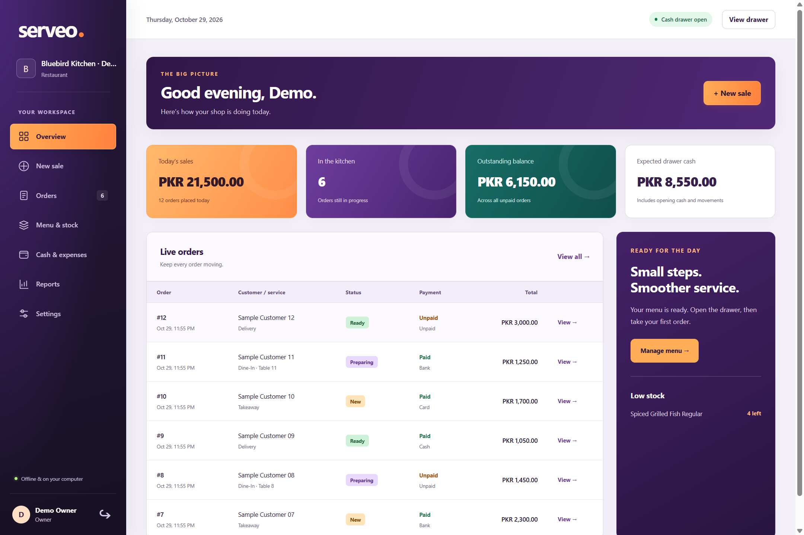
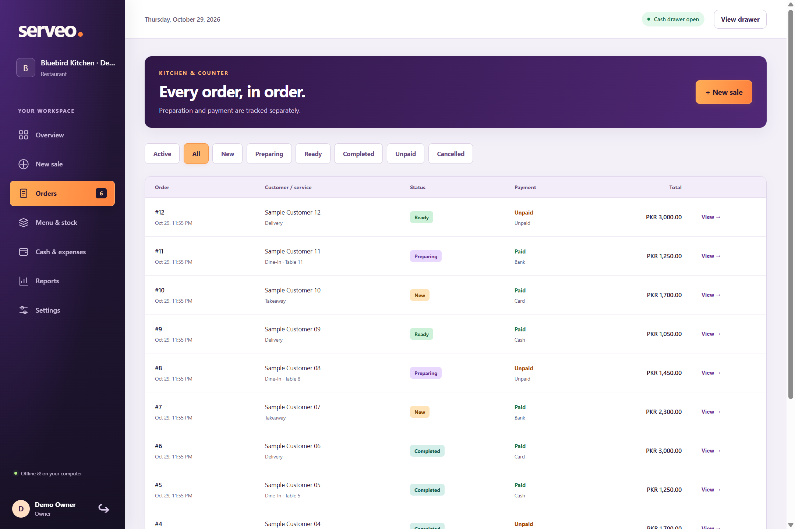
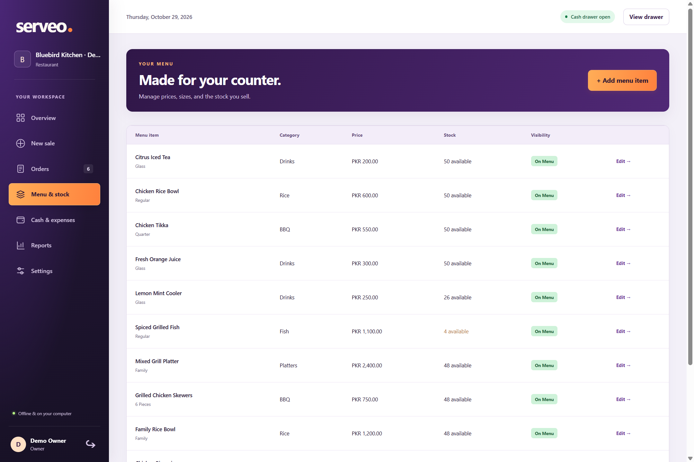
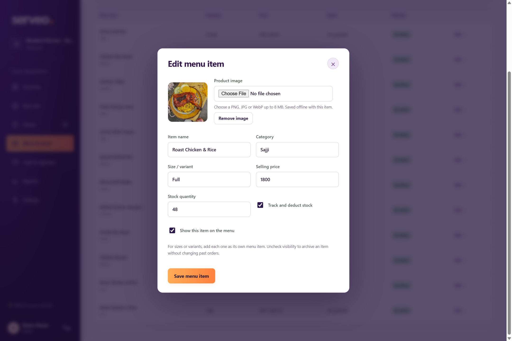
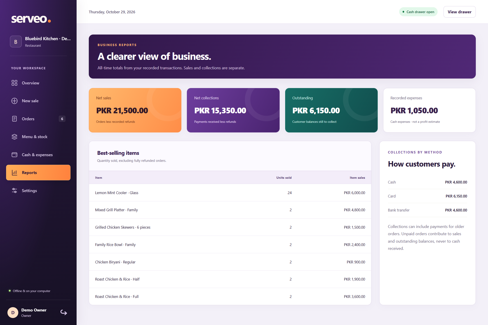
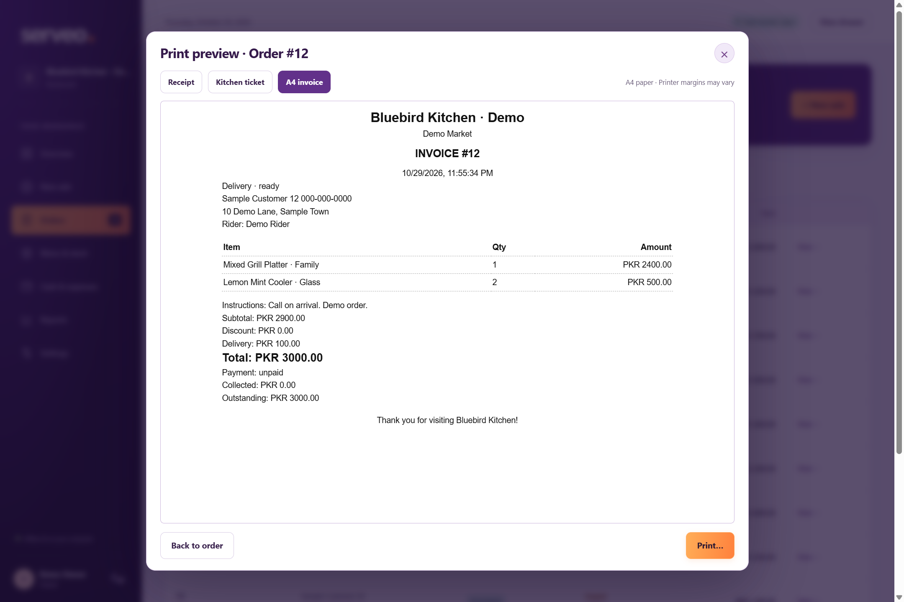

# Serveo

Offline restaurant billing and order management for Windows, for restaurants, cafés, bakeries, BBQ shops and takeaways using one computer.

Each shop configures its own branding, menu and owner account. Everyday operation needs no internet, subscription or cloud account. Current version: **0.1.6**, an early pilot release.

## Screenshots

Captured from the real desktop application using a fictional demo shop and synthetic records. No private business or customer data is shown.

### Point of sale

Browse the menu, build an order and take payment with checkout always visible.



### Overview

Daily sales, active orders, outstanding balances, cash and low-stock alerts.



<details>
<summary>See orders, menu, product images, reports and invoice preview</summary>

### Orders



### Menu and stock



### Product editor



### Reports



### Invoice preview



</details>

## Install

1. Download **Serveo Setup 0.1.6.exe** from [Releases](https://github.com/hassan-pk/serveo/releases).
2. Run the installer and open Serveo from the desktop or Start menu.
3. Configure your shop and create an owner account. No default credentials are included.
4. Add menu items and optional photos in **Menu & stock**.
5. Open the cash drawer, then use **New sale**.

The installer targets 64-bit Windows and is unsigned. Windows may show an unrecognized-publisher warning. Test your workflow and printer before a full trading day. Physical thermal/A4 printing and installation on additional computers still require pilot verification.

## Features

- Dine-in, takeaway and delivery orders, tables, customer details, addresses, riders and kitchen notes.
- Menu categories, variants as separate items, optional stock tracking and archived products.
- Offline product photo upload, replacement and removal. PNG/JPEG/WebP uploads up to 8 MB are resized before saving.
- Cash, card, bank transfer and unpaid orders; cash tender/change and later full collection.
- Owner discounts, delivery fees, full refunds and unpaid cancellation.
- Preparation queue: new, preparing, ready, completed and cancelled.
- Receipt, kitchen ticket and A4 invoice previews with Windows printing.
- Cash expenses, opening/closing drawer and reconciliation differences.
- Lifetime sales, collections, outstanding balances, payment-method totals and best sellers.
- Owner/cashier accounts, password changes and optional recovery tokens.
- Local SQLite database, automatic backups and validated export/restore.

## Daily operation

Delivery requires customer name, phone and address. Dine-in requires a table; unpaid orders require a named customer. Service/customer identity is retained on order screens and documents. Switching away from delivery clears its fee and excludes irrelevant fields.

Sales and collections are separate. Expected cash equals opening cash plus cash payments, minus cash refunds and drawer expenses. Card, bank and unpaid sales do not increase drawer cash.

New orders record original stock deductions. Refunds default to **No stock return / wastage**; choose stock return only for items that can be sold again. Older orders without deduction history require manual stock review. Cancelling a new unpaid order returns recorded deductions.

## Records and recovery

Records live at `%APPDATA%/Serveo/serveo.sqlite`, outside the install folder. Automatic backups run at startup, hourly, at closing and on exit, retaining the latest copy for each UTC date for 30 dates. Export copies to another drive regularly; same-device copies cannot protect against drive loss.

Restore replaces current records/accounts, saves a recovery copy first and signs out. Use the restored backup's credentials. Close Serveo before manually working with database files. Uninstall retains app data. To update, export a backup, close Serveo and install the newer version over the existing copy.

Click your sidebar account name to change your password or set a recovery token. Forgot password requires a token set beforehand. Passwords/tokens are salted and hashed, but database files/backups are not encrypted. Protect them through Windows and disk security.

## Build from source

Use Node.js 24 or newer and npm. Windows is the supported packaging target.

```powershell
git clone https://github.com/hassan-pk/serveo.git
cd serveo
npm ci
npm start
```

| Command | Purpose |
|---|---|
| `npm run dev` | Vite and Electron development mode |
| `npm run build` | Type-check and compile production files |
| `npm test` | Business-rule and print regressions |
| `npm run test:desktop` | Build and run the Electron trading-day regression |
| `npm run test:accounts` | Build and test password/recovery flows |
| `node tests/product-images-desktop.cjs` | Image upload/edit/removal after building |
| `node tests/service-matrix-desktop.cjs` | Service/payment/document checks after building |
| `npm run dist` | Windows NSIS installer in `release/` |
| `npm run pack` | Unpacked Windows application |

Tests use isolated temporary databases through `SERVEO_DATA_DIR`. The service matrix covers three services and four payment methods, 39 document previews, later collection, switching and restart. Automated printing is simulated and does not verify physical paper output.

## Architecture

- `src/main/`: desktop lifecycle, trusted IPC, SQLite business rules and native printing.
- `src/renderer/`: TypeScript screens, forms, styles and bundled assets.
- `src/shared/`: typed API/models, service labels and print templates.
- `tests/`: isolated business, print and desktop checks.
- `build/`: application icons.

The renderer is sandboxed and context-isolated. Writes and permissions are enforced in the main process behind an explicit preload API.

To regenerate the documentation screenshots after building, run `node scripts/generate-screenshots.cjs`. It creates an isolated temporary demo database and writes images to `docs/screenshots/`.

## Current limits

One shop on one computer; no networking or cloud sync. Reports are lifetime summaries, not full accounting or profit reports. Dedicated customer/supplier ledgers, split/partial payments, partial refunds, ingredient recipes/costing, tax/service-charge configuration and historical report browsers are not implemented. Multi-year datasets have not been performance-benchmarked.

No private shop database, business-specific menu import, customer records or owner credentials are included in the repository.

## Contributing and license

Open an issue with the version and steps to reproduce. Use synthetic data, remove personal information from screenshots/logs and never upload business databases.

Serveo code and original project assets use the [MIT License](LICENSE). Photographs and dependencies retain their own licenses; see [third-party notices](THIRD_PARTY_NOTICES.md).
